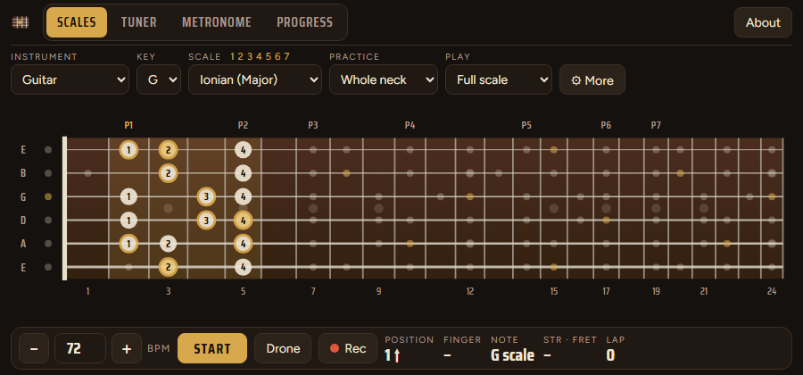
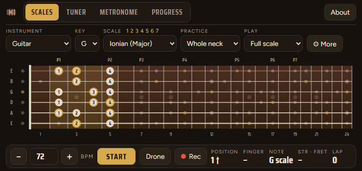
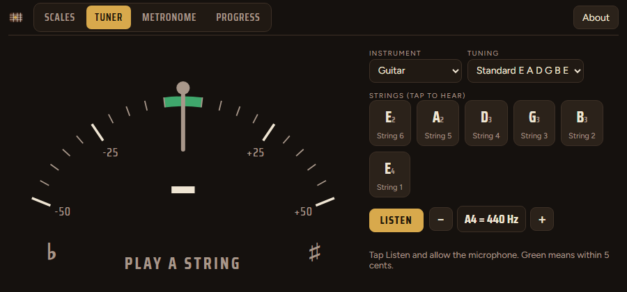
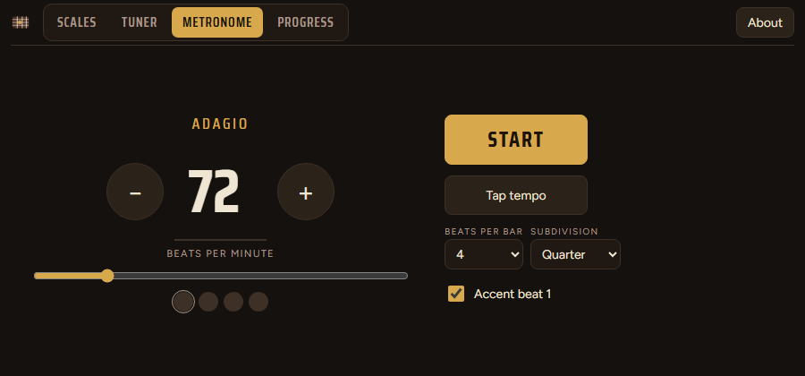
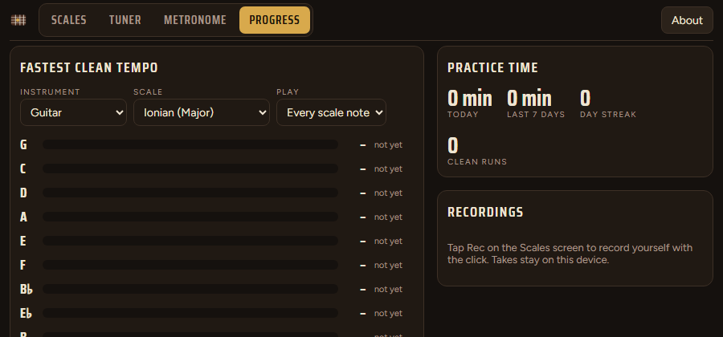
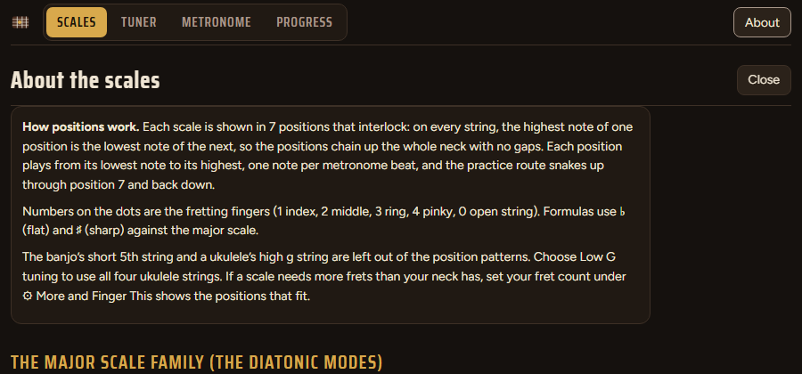

# Finger This

Scale trainer for guitar, banjo and ukulele, with a tuner, metronome, practice log and recorder.

It ships as one web app in two forms:

- **Windows (and any browser):** an installable PWA.
- **Android:** a native APK that wraps the same page in a WebView.

Read `memory.md` for the owner's requirements and the decisions behind them, and `CLAUDE.md` for the full developer guide, before changing behavior.

## Features

- **Scales** — choose key, scale, instrument and metronome settings. Tempo controls with −/+ (hold to repeat), a typed BPM box, and Start/Stop. Each position shows the finger number on every note of the fretboard; notes play one per metronome beat, lowest to highest in a position.
- **Route** — up P1, down P2, up P3 … through position 7, then back down, moving fluidly up and down the neck. Positions interlock (highest note of Pk = lowest note of Pk+1).
- **Tuner** — floating needle dial (flat left, in tune middle, sharp right), nearest note shown, screen turns red when out of tune and green when in tune.
- **Metronome** — −/+ buttons, typed BPM box, Start/Stop.
- **About** — the owner's scale descriptions.
- **Extras** — tunings, note tones, count-in, speed-up trainer, label modes, left-handed fretboard, tap tempo, subdivisions, A4 reference, keyboard shortcuts, root drone, looping between two positions, 3-notes-per-string layout, triad/7th-chord arpeggios with chord tones circled, record & play back, practice log (fastest clean tempo per key, practice time, streak).

## Screenshots

**Scales** (desktop, 900×420) — fretboard with interlocking positions, finger numbers on every note:



**Scales** (phone landscape, 740×350):



**Tuner** — floating needle dial, red when out of tune, green when in tune:



**Metronome**:



**Progress** — practice log and recordings:



**About** — the owner's scale descriptions:



## Layout

| Path | What it is |
|---|---|
| `src/app.html` | The whole app: markup, CSS and JS in one file. Written as page *content*, with no doctype, html, head or body tags; the build adds those. |
| `src/INSTALL.txt` | User install guide, copied into the zip. |
| `build.py` | Builds `dist/finger-this/` (PWA: index.html, manifest, sw.js, icons), `dist/preview.html` and `dist/FingerThis-app.zip`. |
| `build_apk.py` | Builds `dist/FingerThis.apk` from `dist/finger-this/index.html` (run `build.py` first). |
| `android/` | `AndroidManifest.xml`, `res/values/strings.xml` and `src/app/fingerthis/MainActivity.java` (the WebView wrapper). |
| `signing/finger-this.jks` | APK signing key (not in repo). Alias `fingerthis`, store and key password `fingerthis`. |
| `tests/verify_positions.py` | Checks all 3,960 instrument × tuning × scale × key combinations. |

## Build

```bash
python3 build.py                 # PWA folder, preview.html, zip
python3 build_apk.py             # signed APK
python3 tests/verify_positions.py   # must print "bad 0" and "ERRS 0"
```

**APK toolchain.** Google and Maven hosts are blocked in the sandbox, so Gradle and the Android SDK are unavailable. Install the tools from Ubuntu instead:

```bash
apt-get install -y aapt apksigner zipalign android-sdk-platform-23 dalvik-exchange
```

The pipeline is javac → dalvik-exchange (dx) → aapt package → zipalign → apksigner.

**APK rules**

- Java source must be Java 8 and use **no lambdas**, because dx doesn't desugar them; use anonymous classes.
- The code compiles against `android-23/android.jar`, so it can only call API ≤ 23 methods.
- minSdk is 24 and targetSdk is 34.
- **Bump `android:versionCode`** (and versionName) in `AndroidManifest.xml` for every APK release.
- **Always sign with `signing/finger-this.jks`.** A different key won't install over the existing app.
- The WebView loads the page with `loadDataWithBaseURL("https://finger-this.app/")`. That gives a secure origin, which getUserMedia and localStorage need. Don't change the base URL: localStorage is keyed to it.

## Storage

State is persisted to localStorage `fretwise.v1`. The log is `fretwise.log.v1`, IndexedDB is `fretwise`, and the test hook is `window.__fretwise`. These internal names predate the rename from "Fretwise" to "Finger This" — **don't rename them**, or users lose their settings, log and recordings.

## Design

- Dark only: an ebony and rosewood fretboard with brass accents.
- Tokens on `:root`: `--ebony --panel --raised --line --bone --muted --brass --ok --bad`.
- Fonts: Saira Condensed (display) and Figtree (body), with offline fallbacks including `sans-serif-condensed` for Android.
- Android is landscape only. Keep layouts working at 740×350 with no horizontal scroll.
- Musical text always uses the real ♭ and ♯ characters, never `b` or `#`.

## Notes

- The APK hasn't been run on a real phone or emulator; it was only built, signature-verified and its page tested in Chromium.
- Google Play Protect warns on install because the app isn't from the Play Store.
- Without internet, the custom fonts fall back to system fonts.
- In the claude.ai preview, the microphone is unavailable, so the tuner and recording don't work there.
